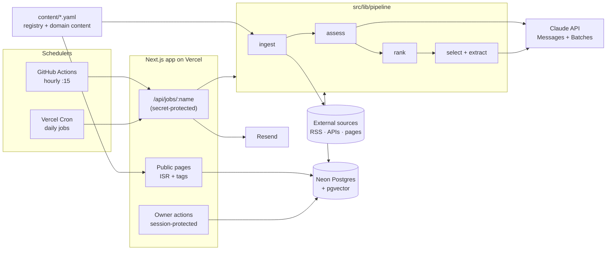

# Technology Frontier Radar — Architecture

Status: draft v0.3 (2026-10-20). v0.3 replaces triage with one assessment pass and adds ranking (§7). v0.2 drops the daily brief. This describes how [REQUIREMENTS.md](REQUIREMENTS.md) gets built. Section numbers like "R§4" point to the requirements doc.

---

## 1. Constraints that shape the design

| Constraint | Source | Consequence |
|---|---|---|
| Vercel Hobby cron: **at most once a day per job**, and it fires anywhere in the scheduled hour | Vercel docs (checked 2026-10-18) | Hourly ingestion can't run on Vercel Cron. A GitHub Actions schedule triggers it instead. Daily jobs are scheduled one hour before their deadline |
| Vercel Hobby functions: **max 300 s** | Vercel docs | Every job is resumable and stops itself at a 240 s time budget |
| Neon Free: **1 GB storage**, 100 CU-hours/month, scales to zero | Neon docs (checked 2026-10-18) | No full raw payloads are stored. Public pages are cached so visitors don't wake the DB |
| **$20/month LLM cap** | R§4 Phase 1 | Source filters drop noise before storage; one assessment call per 20 items; extraction (later) only for top-ranked items. Every call is checked against the cap first (§8.2) |
| **Public, read-only** site | R§2 | Pages are static/ISR. Owner controls hydrate client-side. Source text is shown as excerpts only. LLM output is treated as untrusted |
| One developer, one user | R§2 | One Next.js app and one database. No queues, workers or microservices |

## 2. System overview



One deployable unit. Jobs are ordinary route handlers that call plain TypeScript functions in `src/lib/pipeline`. The same functions run locally from a CLI (`npm run job <name>`), so you never need the HTTP layer to develop or debug them.

## 3. Technology choices

| Concern | Choice | Why / rejected alternatives |
|---|---|---|
| Framework | Next.js 15 (App Router), TypeScript, Tailwind | One codebase covers pages, route handlers and server actions. Rejected: separate API + SPA (two deployables) |
| DB | Neon Postgres, `pgvector`, `tsvector` full-text | Hosted, free tier, has vectors for Phase 2. Rejected: SQLite (no good serverless story on Vercel), Supabase (more than needed) |
| ORM / migrations | Drizzle ORM + drizzle-kit, Neon serverless driver | Typed SQL, migrations as files, works over HTTP from serverless. Rejected: Prisma (heavier cold starts) |
| Validation | zod | One schema library for registry YAML, connector configs and LLM structured outputs |
| Feed parsing | `rss-parser` (RSS/Atom), `fetch` + zod (JSON APIs) | |
| Page monitor | `cheerio` over static HTML | No headless browser (R§4 Phase 0) |
| LLM | `@anthropic-ai/sdk`. Structured outputs through `output_config.format`, Message Batches for extraction | §8 |
| Email | Resend | Simple SDK, free tier |
| Auth | Password checked against a scrypt hash from env, session JWT signed with `jose` | Single user, no auth provider needed |
| Tests | Vitest, recorded fixtures | No live network or LLM calls in CI |
| Hourly scheduler | GitHub Actions `schedule` + `curl` with a secret | Free. Vercel Hobby can't run hourly jobs |

## 4. Repository layout

```
content/                      # human-edited, reviewed in git, validated in CI
  sources/*.yaml              # one file per domain group; source registry (R§5.2)
  domains/*.yaml              # 15 domains: subfields, signals, research/products/people
  people.yaml                 # specialists + cross-disciplinary thinkers
  topics.yaml                 # topic tags per domain, the only tags assessment may use
  config.yaml                 # score weights, rank bonuses, budget, model ids, prices
src/
  app/                        # pages (§10), /api/jobs/[name], /api/me, /login
  lib/
    registry/                 # YAML loader + zod schemas; build-time import
    connectors/               # one file per method: rss, arxiv, hf-papers, github-search,
                              #   biorxiv, ctgov, hf-models, page-monitor; index.ts = registry
    http/                     # fetch wrapper: UA, timeout, conditional GET, robots, retry
    pipeline/                 # ingest, canonicalize, assess, rank, extract (later), ...
    llm/                      # client, budget ledger, prompts/<name>.v<N>.ts, output schemas
    db/                       # drizzle schema, client, queries
    email/                    # templates + send
    auth/                     # session, password check, rate limit
  cli/job.ts                  # `npm run job ingest` etc., same functions as the routes
drizzle/                      # generated SQL migrations
tests/                        # unit + fixture tests; tests/fixtures/<source-id>/*.xml|json|html
.github/workflows/            # ci.yml, hourly.yml
vercel.json                   # daily crons
```

Domain and people content is **static content**, compiled in at build time. The DB never stores it. Sources are the exception: they live in YAML, but each source also has runtime state in the DB (§6).

## 5. Ingestion

### 5.1 Connector contract

```ts
interface Connector<C> {
  method: "rss" | "atom" | "arxiv" | "hf-papers" | "github-search"
        | "biorxiv" | "ctgov" | "hf-models" | "page-monitor";
  configSchema: z.ZodType<C>;          // validates the source's `filter`/config block
  fetch(ctx: {
    source: Source; config: C;
    state: SourceState;                // cursor, etag, last-modified, monitor baseline
    http: Http; now: Date;
  }): Promise<{ items: NormalizedItem[]; state: Partial<SourceState> }>;
}

type NormalizedItem = {
  url: string; externalId?: string;    // arXiv id, DOI, NCT id, HN id, repo full_name
  title: string; authors?: string[]; publishedAt?: Date;
  excerpt?: string;                    // ≤300 chars, plain text
  abstract?: string;                   // only where licensed (arXiv/bioRxiv metadata, CT.gov)
  signals?: Record<string, number>;    // hn_points, stars, stars_7d, comments...
  categories?: string[];               // feed categories, matched by the source's `filter`
};
```

A connector is a pure function of (config, state, HTTP). It never writes to the DB, which makes fixture tests trivial: replay the recorded HTTP, check the items.

### 5.2 Ingest job

1. Sync the registry: upsert `sources` rows from YAML (id, config hash, enabled). Disable rows whose YAML entry was removed.
2. Select due sources: `enabled AND next_due_at <= now()`, ordered by `next_due_at`.
3. Run connectors with concurrency 4 until the **240 s budget** is used up. Sources left over stay due for the next run.
4. Apply the source's `filter` (categories, title and URL patterns from the registry). Items that fail are dropped before storage. Then, for each item: **canonicalize**. Lowercase the host, force https, strip `utm_*`/`ref`/fragments, map arXiv `pdf/`→`abs/` and drop the version suffix, and use a DOI when present. Then **upsert** on `canonical_url`. If the item already exists, add an `item_mentions` row instead (the same paper arriving from HF Papers and a lab blog is one item with two mentions; mentions are a signal in their own right).
5. Update `source_state`: cursor, ETag/Last-Modified, `last_success_at` or `last_error`, `consecutive_failures`, `next_due_at = now + frequency`. On failure, back off exponentially, capped at 24 h.
6. The `hourly` job then assesses new items (§7.2) and re-ranks recent ones (§7.3).

Idempotent: re-running steps 2–6 can't duplicate items (unique keys). Each source is processed in its own transaction, so a timeout loses at most one source's work, and that source is retried on the next run.

### 5.3 Page monitor specifics

The YAML config: `{ listUrl, linkSelector, dateSelector?, allowPrefix, minLinks }`.
- `robots.txt` is fetched and cached for 24 h. Disallowed paths turn into a health error.
- Each run extracts the links, filters them by `allowPrefix`, and diffs them against `state.seenLinks`. A capped set (the last 500) is stored in `source_state.data`.
- **Breakage guard:** if the link count is `< minLinks` or below 20% of `state.lastLinkCount`, record an error and emit no items.
- Each new link's page is fetched once, for `<title>`, `og:description` and `article:published_time`. That fills `title`, `excerpt` and `publishedAt`.

### 5.4 Source-specific notes
- **HF Daily Papers:** papers below `minUpvotes` are skipped. Because each run re-reads the day's list, a paper that climbs past the floor later is picked up then.
- **One feed, two sources:** OpenAI publishes research and releases in one RSS feed. Two registry entries read it, each keeping different feed categories, so research lands in the scientific layer and releases in the product layer.
- **Unused connectors:** `arxiv`, `biorxiv`, `ctgov` and `github-search` stay in the code, but no registry entry uses them. Their raw output (every new preprint, trial or popular repo) was mostly noise for this site.

### 5.5 Pruning
The daily `maintenance` job deletes mentions from sources removed from the registry, then deletes items left with no mentions, and re-derives each item's `layer` and `kind` from its first source. Renaming a source's `id` is therefore the way to apply a tightened filter to items already stored.

## 6. Data model (Phase 0–1)

```
sources          id PK (slug), enabled, tier, domains text[], layer, method,
                 config jsonb, config_hash, updated_at
source_state     source_id PK→sources, cursor jsonb, etag, last_modified,
                 last_success_at, last_error, last_error_at, consecutive_failures,
                 next_due_at, data jsonb            -- page-monitor seen links etc.

items            id PK, canonical_url UNIQUE, external_id, external_kind,
                 first_source_id→sources, title, authors text[], published_at,
                 fetched_at, excerpt varchar(300), abstract text NULL,
                 domains text[],                    -- the assessment's once assessed
                 source_domains text[],             -- what the source said
                 layer, kind, tier,
                 tags text[], quality smallint NULL, rank real NULL  -- copied from the assessment / §7.3
                 search tsvector GENERATED (title || excerpt || abstract)
                 UNIQUE(external_kind, external_id) WHERE external_id IS NOT NULL
item_mentions    item_id→items, source_id→sources, seen_at, url, signals jsonb
                 PK(item_id, source_id, seen_at::date)

item_assessments item_id PK→items, prompt_version, model, assessed_at, relevant bool,
                 domains text[], topics text[], proposed_topics text[], contribution,
                 artifacts text[], novelty..maturity smallint, quality smallint,
                 takeaway text, rationale text, llm_call_id→llm_calls
developments     item_id PK→items, technology, subfield, claim, previous_limitation,
                 new_capability, quantitative_improvement jsonb NULL,
                 evidence_type, claim_status, maturity, significance,
                 confidence smallint, confidence_reason, evidence_item_ids bigint[],
                 llm_call_id→llm_calls, prompt_version

llm_calls        id PK, purpose, model, prompt_version, status (ok | failed),
                 input_tokens, output_tokens, cache_read_tokens, cache_write_tokens,
                 cost_usd numeric, item_count, error, created_at
llm_batches      id PK, anthropic_batch_id, purpose, status, submitted_at, ended_at,
                 item_ids bigint[]

job_runs         id PK, job, started_at, finished_at, status, stats jsonb, error
feedback         id PK, target_kind, target_id, rating smallint, note, created_at
login_attempts   ip_hash, at                       -- rate limiting
```

**Storage estimate:** ~600 raw items/day × ~1.2 KB (excerpt + abstract + row overhead) ≈ 0.7 MB/day ≈ **260 MB/year**. That leaves room in 1 GB for indexes, mentions and Phase 2 embeddings (1024-dim float4 ≈ 4 KB × ~20 developments/day ≈ 30 MB/year). Abstracts make up the bulk. Once storage passes 70%, the health page warns. The fix is upgrading Neon, not deleting data (R§9 retention). With the primary-source registry the real volume is closer to 100 items/day.

**Phase 2 adds:** `reports(id, kind enum(weekly, monthly), period, status, body jsonb, UNIQUE(kind, period))`, `embeddings(item_id, model, vector(1024))`, `trends`, `trend_members(trend_id, item_id, added_by)`, `trend_scores`.
**Phase 3 adds:** `metric_series(kind, key, date, value)` for OpenAlex concept counts, repo stars and package downloads.

## 7. Processing pipeline

### 7.1 Filtering (rules, no LLM)
Source filters (R§5.2 `filter`) run at ingestion, so filtered items are never stored. There is no separate prefilter: every stored item, in every tier, is assessed.

### 7.2 Assess (Claude Opus 5.5, synchronous, hourly) — `pipeline/assess.ts`
- Runs in the `hourly` job after ingestion, until 60 s before the job's 240 s budget. Takes unassessed items newest first, 20 per request (`content/config.yaml`). `npm run job assess -- --retag` also redoes items assessed by an older prompt version; `--dry-run` calls the model, records the cost, prints the results and writes nothing.
- Input: a JSON array of `{id, source, sourceKind, layer, title, authors≤3, published, text}`, where `text` is the abstract cut to 1500 characters, or the excerpt. The system prompt (domains, their topics, contribution types, score anchors) is the same in every call and is cached.
- Output: structured output (`output_config.format`), one result per item: `relevant, domains[], topics[], proposed_topics[], contribution, artifacts[], novelty, magnitude, evidence, breadth, maturity, takeaway, rationale`.
- The SDK turns zod enums and ranges into description hints, so the API does not enforce them. Each result is therefore checked on its own: a result that doesn't match the item schema, or whose id wasn't in the batch, is dropped and the item retried next run. Unknown topics become proposals, unknown domains are dropped (falling back to the source's), so one bad value never costs the batch.
- Writes `item_assessments`, then copies `domains`, `tags`, `quality` and the re-derived `tier` onto `items`.
- Effort `low`; thinking is adaptive (always on for Opus 5.5). Server-side refusal fallback is on (`fallbacks: "default"`).

### 7.3 Rank (rules, hourly) — `pipeline/rank.ts`
- `rank = quality (or 40 if unassessed) + 8 per further source (max +16) + up to +10 from HF upvotes (log scale, full at 200) + source priority (+5 / 0 / −5) − 40 if not relevant`. All numbers in `content/config.yaml`.
- Recomputed every hour for items from the last 60 days (and any never ranked), because upvotes and mentions keep changing.
- "Top" views sort by rank within a window (7 days, 30 days, all time) instead of decaying it over time.

### 7.4 Select + extract (not built yet; Claude Sonnet 5.5, Message Batches, daily)
- **Select** (04:00 Dubai, no LLM): the top 25 items by rank from the last 36 h, with a cap per domain so AI can't take every slot.
- **Extract:** one Message Batch (50% price) with one request per item: the item plus any mentions' titles → Development fields (R§6.3) as structured output.
- The hourly job polls open batches and writes results, then `revalidateTag('items')`.

### 7.5 Weekly / monthly overviews (Phase 2–3)
- These are Opus synchronous jobs that read developments and trends, never raw items.
- **Link integrity:** the model can only refer to items by `item_id`. Every URL on the page and in any email comes from the `items` table, never from model text. Entries with unknown IDs are dropped.
- If the budget is exhausted, the report is skipped and the health page says so.

## 8. LLM layer

### 8.1 Model mix and cost estimate

Prices from the current Claude model table: Haiku 5.5 $0.10/$0.50, Sonnet 5.5 $2/$10, Opus 5.5 $4/$20 per million input/output tokens. Batches cost 50% less. Volumes are estimates: the real volume is ~30 new items/day. Replace with measurements from `llm_calls` after week 1.

| Step | Model | Volume/day | Est. tokens/day (in / out incl. thinking) | Est. $/month |
|---|---|---|---|---|
| Assess | `claude-opus-5-5`, effort low | ~30 items, 2 calls | 15k + cached system / ~10k | ~$6–8 |
| Extraction | `claude-sonnet-5-5`, batch, effort low | 25 items | 60k / 40k | ~$7.80 |
| Weekly report (P2) | `claude-opus-5-5` | ~4 calls/month | 30k / 10k per call | ~$1.40 |
| Monthly report (P3) | `claude-opus-5-5` | 1 call/month | 60k / 20k per call | ~$0.60 |
| **Total** | | | | **~$16–18**, close to the cap |

Assessment uses Opus because judging what is new is the point of the score, and at this volume it fits. With extraction added, the total gets close to the cap: if measured spend says so, move assessment to `claude-sonnet-5-5` (about half the cost) in `content/config.yaml`, no code change.

### 8.2 Budget guard (enforces R§4 Phase 1) — `llm/budget.ts`

```
before each call:
  worst = (system + user chars) / 3 × inPrice + maxTokens × outPrice
  if spent_this_month + worst > cap                                  → stop
  allowance_today = (cap − spent_before_today) / days_left_in_month (today included)
  if spent_today + worst > allowance_today × 1.5                     → stop
  (1.5 lets one day spend more as long as the monthly total stays capped)
after each call: insert llm_calls with cost from the actual usage (incl. cache read/write rates)
```

- No reservations: jobs never run concurrently (§9 job lock), so reading the sums and then calling can't race.
- A stop ends the LLM step for this run without failing the job; items wait, and `/sources` shows how many.
- Price table in `content/config.yaml`, keyed by model ID. A response served by a fallback model is priced at that model's rate when it's in the table.
- Not built yet: the 80% alert email.
- Tests: simulated cap → no LLM call is made (R§4 acceptance).

### 8.3 Prompts and outputs
- Prompts live in `src/lib/llm/prompts/<name>.v<N>.ts` and export `version`, `buildSystem`, `buildUser` and the output schema. Every stored output records `prompt_version` (R§9). Bump the version when the prompt changes, then `--retag`.
- Every response is checked with `stop_reason` before any content is read. Anything but `end_turn` is a failed call: recorded with its cost, and its items retried next run.
- Output schemas are zod, converted to JSON Schema for `output_config.format` by the SDK, and checked again with zod on receipt, item by item (§7.2).

### 8.4 Untrusted input (prompt injection)
Source text is written by third parties and the site is public, so:
- The LLM gets **no tools**. It only returns structured JSON, and the schema is checked.
- Source content goes into a clearly delimited data block. The system prompt says that block is data to classify, never instructions.
- Model text is rendered as escaped plain text. No HTML/Markdown passthrough, and links only come from the DB (§7.5).
- Item IDs in outputs must belong to the input set.

### 8.5 Subscription mode (local Claude Code CLI) — `llm/claude-code.ts`
- `ASSESS_PROVIDER=claude-code` makes the assess step run each batch as `claude -p --model <id> --effort <level> --output-format json --json-schema <schema> --system-prompt <prompt> --tools "" --strict-mcp-config --no-session-persistence`, in an empty temp directory, with the items on stdin. API keys are removed from the child's environment so the subscription login is used.
- The same safety posture as §8.4: no tools, no MCP servers, no project files, output constrained to the schema (the CLI validates it and retries on mismatch; draft-07, so zod's `$schema` marker is dropped). The per-item checks of §7.2 still run.
- Calls are stored with `llm_calls.billing = 'subscription'` and `cost_usd = 0`, so they don't count toward the cap; the job stats report the CLI's API-equivalent cost.
- Runs only on the owner's Mac: `scripts/assess-cron.sh` installs a launchd agent (`StartInterval` 3600 s, so a run missed during sleep happens on wake) that assesses the production database from `.env.cron` and then calls `/api/jobs/rank` to refresh the site's cache. The cloud `hourly` job skips assessment when it has no `ANTHROPIC_API_KEY`.
- Trade-offs: assessment stalls while the Mac sleeps, and usage counts toward the subscription's limits, shared with interactive use. Switching to the API is `ANTHROPIC_API_KEY` in Vercel plus `npm run cron:uninstall`.

## 9. Scheduling

All times are Asia/Dubai (UTC+4). Vercel Hobby fires anywhere within the hour, so each daily job is scheduled one hour before its deadline.

| Job | Trigger | UTC cron | Fires (Dubai) | Does |
|---|---|---|---|---|
| `hourly` | GitHub Actions | `15 * * * *` | every hour | ingest due sources → assess (only with `ANTHROPIC_API_KEY`) → rank |
| `assess` (subscription mode) | launchd on the owner's Mac | every 60 min | while awake | assess → rank via `/api/jobs/rank` (§8.5) |
| `extract` (P1) | Vercel Cron | `0 0 * * *` | 04:00–04:59 | select top 25 → submit extraction batch |
| `hourly` (safety net) | Vercel Cron | `30 1 * * *` | 05:30–06:29 | the same job, in case GitHub Actions is down |
| `weekly` (P2) | Vercel Cron | `0 4 * * 6` | Sat 08:00–08:59 | weekly overview |
| `monthly` (P3) | Vercel Cron | `0 4 1 * *` | 1st, 08:00–08:59 | monthly overview |
| `maintenance` | Vercel Cron | `0 23 * * *` | 03:00–03:59 | registry sync, storage check, failure alerts |

- A job doesn't start while a `job_runs` row for the same job is `running` and less than 6 minutes old, so overlapping triggers do nothing. (Advisory locks don't survive Neon's transaction-mode pooler.)
- Every run is written to `job_runs`.
- The hourly GitHub workflow has a `workflow_dispatch` trigger for manual runs.
- **Job auth:** `Authorization: Bearer $CRON_SECRET` (Vercel Cron sends this automatically when `CRON_SECRET` is set; the GitHub workflow sends it from repo secrets). Requests without it get 401.
- Page monitors and `daily` sources get `next_due_at` once a day, so the hourly job only polls them once a day.

## 10. Web app

### 10.1 Rendering strategy
- **Public pages** are server components cached with `unstable_cache` / tagged fetches: `feed`, `reports`, `sources`, `domain:<slug>`. After jobs write, they call `revalidateTag`. Visitors hit the cache and the DB stays asleep.
- **Feed with filters/search** is dynamic (query params) but paginated (50 per page) with indexed queries: `(status, published_at)`, GIN on `domains`, GIN on `search`.
- **Owner controls** are client components that call `/api/me`. If signed in, they render rating buttons, notes and cost figures. Public HTML stays identical for everyone, which is what keeps it cacheable.
- **Domain and people pages** are fully static (built from `content/`), plus a cached "recent items" section.
- Every page sends `<meta name="robots" content="noindex">` plus an `X-Robots-Tag` header (R§2).

### 10.2 Routes

| Route | Phase |
|---|---|
| `/` | 0, the week's top items in each domain |
| `/domains` | 0, domain × layer counts for the week |
| `/d/[slug]?sort=&layer=&tag=&all=&page=`, `/d/[slug]/about` | 0 |
| `/feed?q=&domain=&layer=&tag=&source=&sort=&all=&page=` | 0 |
| `/sources`, `/sources/[id]` | 0, health included |
| `/people` | 0 |
| `/reports`, `/reports/[kind]/[period]` | 2 |
| `/trends`, `/trends/[id]` | 2 |
| `/login` | 0 |
| `/api/jobs/[name]` (POST, secret) | 0 |
| `/api/me` | 0 |

Owner mutations are **server actions** that call `requireOwner()` first.

### 10.3 Auth
- `OWNER_PASSWORD_HASH` (scrypt, generated with `npm run hash-password`).
- `/login` compares in constant time and issues a `jose`-signed JWT in an `HttpOnly; Secure; SameSite=Lax` cookie that lasts 90 days.
- Rate limit: 5 failed attempts per IP hash per 15 min, kept in `login_attempts`.

## 11. Email
- Resend, `from` set by `EMAIL_FROM` (the provider's test sender until a domain is set up, R§12 Q1), `to` = `OWNER_EMAIL`.
- **Alerts** (at most one of each kind per day): budget hit 80%, a source failing for 3+ consecutive days, a page-monitor breakage guard tripping, storage over 70%.
- Each send is recorded in `job_runs`, so retries don't send twice.

## 12. Observability
- The `job_runs` table drives the `/sources` health view: last run, each source's status, items per source over 7 days, monitor guard trips.
- Owner-only on the same page: LLM spend today/month, open reservations, batches in flight, DB storage used.
- Structured `console` logs (JSON lines) end up in Vercel logs. That's enough for one user, so no APM.

## 13. Testing and CI
- **Unit:** canonicalization (an arXiv/DOI/UTM table), source filters, quality and rank formulas, budget decisions, assessment response handling (stop reasons, unknown ids, invalid items, unknown topics) and the batch loop with a fake LLM client.
- **Connector fixtures:** recorded responses under `tests/fixtures/<source-id>/`, run through the connector, results snapshotted. A script refreshes them: `npm run fixtures:record <id>`.
- **LLM steps:** prompt builders are snapshot-tested. Response handling is tested with recorded JSON. CI never makes live LLM calls.
- **Registry validation:** CI loads every YAML file through zod and fails on unknown domains, duplicate IDs, or connector config that doesn't validate.
- **Live source probe** (manual, not CI): `npm run probe:sources` hits every enabled endpoint and prints status and item counts. It's the same check that grounded R§5.1.
- `ci.yml`: typecheck, lint, vitest, registry validation, `next build`.

## 14. Environments and secrets
- **Local:** `.env.local` → a Neon dev branch (free tier allows 10 branches). `npm run job <name>` runs any job directly.
- **Production:** Vercel env vars: `DATABASE_URL`, `ANTHROPIC_API_KEY`, `RESEND_API_KEY`, `EMAIL_FROM`, `OWNER_EMAIL`, `OWNER_PASSWORD_HASH`, `SESSION_SECRET`, `CRON_SECRET`, `GITHUB_TOKEN` (search API rate limit). The GitHub repo secrets hold `CRON_SECRET` and the app URL.
- Migrations run with `drizzle-kit migrate` as a deploy step (Vercel build command), against the production branch.

## 15. Phase 2–3 extension points
- **Embeddings:** Claude doesn't offer an embeddings endpoint, so Phase 2 needs a provider (Voyage AI is the obvious choice). It's a small cost (~20 developments/day) but **it's an extra vendor and API key, and that needs deciding at the start of Phase 2.**
- **Trend clustering:** incremental. Each new development is matched to the nearest trend centroid (cosine distance under a threshold), otherwise it becomes a candidate. A candidate is promoted once the R§4 Phase 2 rule holds. The owner can merge/split in the UI, which overrides membership.
- **Acceleration metrics:** a `metrics` daily job appends to `metric_series` (OpenAlex counts per concept, GitHub stars, PyPI/npm downloads for tracked packages). Growth is computed in SQL with window functions.
- **Scoring:** the LLM fills `trend_scores` using the R§7 rubric. Weights come from `config.yaml`. Owner overrides are stored separately and win.

## 16. Build order for Phase 0

1. Scaffold: Next.js, Tailwind, Drizzle, Neon dev branch, CI.
2. `content/` schemas + loader + YAML for all 15 domains, people and the 26 starter sources. Validate in CI.
3. Static pages: domains, people, sources (no state yet).
4. DB schema + migrations. `http` wrapper. Connectors with fixtures, feed/API ones first.
5. Ingest job + canonicalize + mentions + CLI runner. Run locally against all sources.
6. Feed page with filters/search. Health view.
7. Page monitor connector + configs for the 5 feedless sources.
8. Deploy: Vercel, Neon production branch, `vercel.json` crons, GitHub hourly workflow, login.
9. Check Phase 0 acceptance (R§4): 21/26 automatic, no duplicates, one source failing in isolation.
