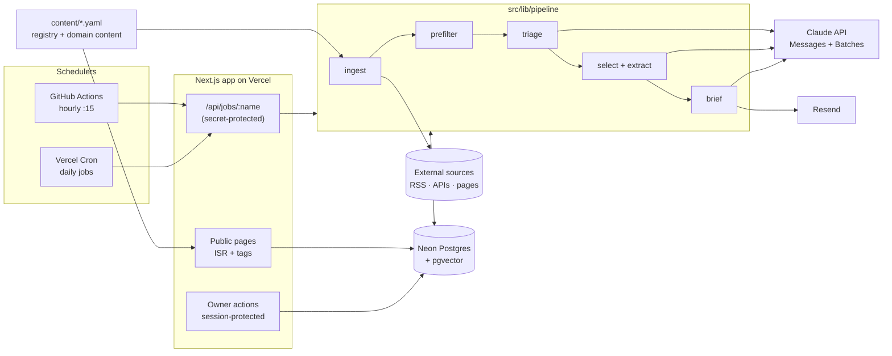

# Technology Frontier Radar — Architecture

Status: draft v0.1 (2026-10-18). This describes how [REQUIREMENTS.md](REQUIREMENTS.md) gets built. Section numbers like "R§4" point to the requirements doc.

---

## 1. Constraints that shape the design

| Constraint | Source | Consequence |
|---|---|---|
| Vercel Hobby cron: **at most once a day per job**, and it fires anywhere in the scheduled hour | Vercel docs (checked 2026-10-18) | Hourly ingestion can't run on Vercel Cron. A GitHub Actions schedule triggers it instead. Daily jobs are scheduled one hour before their deadline |
| Vercel Hobby functions: **max 300 s** | Vercel docs | Every job is resumable and stops itself at a 240 s time budget |
| Neon Free: **1 GB storage**, 100 CU-hours/month, scales to zero | Neon docs (checked 2026-10-18) | No full raw payloads are stored. Public pages are cached so visitors don't wake the DB |
| **$20/month LLM cap** | R§4 Phase 1 | Rules filter first, then a cheap triage model, then batched extraction. A reserve-then-settle budget ledger enforces the cap |
| **Public, read-only** site | R§2 | Pages are static/ISR. Owner controls hydrate client-side. Source text is shown as excerpts only. LLM output is treated as untrusted |
| One developer, one user | R§2 | One Next.js app and one database. No queues, workers or microservices |

## 2. System overview



One deployable unit. Jobs are ordinary route handlers that call plain TypeScript functions in `src/lib/pipeline`. The same functions run locally from a CLI (`npm run job <name>`), so you never need the HTTP layer to develop or debug them.

## 3. Technology choices

| Concern | Choice | Why / rejected alternatives |
|---|---|---|
| Framework | Next.js 15 (App Router), TypeScript, Tailwind | One codebase covers pages, route handlers and server actions. Rejected: separate API + SPA (two deployables) |
| DB | Neon Postgres, `pgvector`, `tsvector` full-text | Hosted, free tier, has vectors for Phase 2. Rejected: SQLite (no good serverless story on Vercel), Supabase (more than needed) |
| ORM / migrations | Drizzle ORM + drizzle-kit, Neon serverless driver | Typed SQL, migrations as files, works over HTTP from serverless. Rejected: Prisma (heavier cold starts) |
| Validation | zod | One schema library for registry YAML, connector configs and LLM structured outputs |
| Feed parsing | `rss-parser` (RSS/Atom), `fetch` + zod (JSON APIs) | |
| Page monitor | `cheerio` over static HTML | No headless browser (R§4 Phase 0) |
| LLM | `@anthropic-ai/sdk`. Structured outputs through `output_config.format`, Message Batches for extraction | §8 |
| Email | Resend | Simple SDK, free tier |
| Auth | Password checked against a scrypt hash from env, session JWT signed with `jose` | Single user, no auth provider needed |
| Tests | Vitest, recorded fixtures | No live network or LLM calls in CI |
| Hourly scheduler | GitHub Actions `schedule` + `curl` with a secret | Free. Vercel Hobby can't run hourly jobs |

## 4. Repository layout

```
content/                      # human-edited, reviewed in git, validated in CI
  sources/*.yaml              # one file per domain group; source registry (R§5.2)
  domains/*.yaml              # 15 domains: subfields, signals, research/products/people
  people.yaml                 # specialists + cross-disciplinary thinkers
  keywords.yaml               # prefilter keyword lists per domain
  config.yaml                 # scoring weights, budget, schedule, brief sizes, model ids
src/
  app/                        # pages (§10), /api/jobs/[name], /api/me, /login
  lib/
    registry/                 # YAML loader + zod schemas; build-time import
    connectors/               # one file per method: rss, arxiv, hf-papers, github-search,
                              #   biorxiv, ctgov, hn, page-monitor; index.ts = registry
    http/                     # fetch wrapper: UA, timeout, conditional GET, robots, retry
    pipeline/                 # ingest, canonicalize, prefilter, triage, extract, brief, ...
    llm/                      # client, budget ledger, prompts/<name>.v<N>.ts, output schemas
    db/                       # drizzle schema, client, queries
    email/                    # templates + send
    auth/                     # session, password check, rate limit
  cli/job.ts                  # `npm run job ingest` etc., same functions as the routes
drizzle/                      # generated SQL migrations
tests/                        # unit + fixture tests; tests/fixtures/<source-id>/*.xml|json|html
.github/workflows/            # ci.yml, hourly.yml
vercel.json                   # daily crons
```

Domain and people content is **static content**, compiled in at build time. The DB never stores it. Sources are the exception: they live in YAML, but each source also has runtime state in the DB (§6).

## 5. Ingestion

### 5.1 Connector contract

```ts
interface Connector<C> {
  method: "rss" | "atom" | "arxiv" | "hf-papers" | "github-search"
        | "biorxiv" | "ctgov" | "hn" | "page-monitor";
  configSchema: z.ZodType<C>;          // validates the source's `filter`/config block
  fetch(ctx: {
    source: Source; config: C;
    state: SourceState;                // cursor, etag, last-modified, monitor baseline
    http: Http; now: Date;
  }): Promise<{ items: NormalizedItem[]; state: Partial<SourceState> }>;
}

type NormalizedItem = {
  url: string; externalId?: string;    // arXiv id, DOI, NCT id, HN id, repo full_name
  title: string; authors?: string[]; publishedAt?: Date;
  excerpt?: string;                    // ≤300 chars, plain text
  abstract?: string;                   // only where licensed (arXiv/bioRxiv metadata, CT.gov)
  signals?: Record<string, number>;    // hn_points, stars, stars_7d, comments...
  linkedUrls?: string[];               // e.g. the article an HN post points to
};
```

A connector is a pure function of (config, state, HTTP). It never writes to the DB, which makes fixture tests trivial: replay the recorded HTTP, check the items.

### 5.2 Ingest job

1. Sync the registry: upsert `sources` rows from YAML (id, config hash, enabled). Disable rows whose YAML entry was removed.
2. Select due sources: `enabled AND next_due_at <= now()`, ordered by `next_due_at`.
3. Run connectors with concurrency 4 until the **240 s budget** is used up. Sources left over stay due for the next run.
4. For each item: **canonicalize**. Lowercase the host, force https, strip `utm_*`/`ref`/fragments, map arXiv `pdf/`→`abs/` and drop the version suffix, and use a DOI when present. Then **upsert** on `canonical_url`. If the item already exists, add an `item_mentions` row instead (the same paper arriving from arXiv, HF Papers and HN is one item with three mentions; mentions are a signal in their own right).
5. Update `source_state`: cursor, ETag/Last-Modified, `last_success_at` or `last_error`, `consecutive_failures`, `next_due_at = now + frequency`. On failure, back off exponentially, capped at 24 h.
6. Run the **prefilter** (§7.1) on new items in the same job. It's cheap and needs no LLM.

Idempotent: re-running steps 2–6 can't duplicate items (unique keys). Each source is processed in its own transaction, so a timeout loses at most one source's work, and that source is retried on the next run.

### 5.3 Page monitor specifics

The YAML config: `{ listUrl, linkSelector, dateSelector?, allowPrefix, minLinks }`.
- `robots.txt` is fetched and cached for 24 h. Disallowed paths turn into a health error.
- Each run extracts the links, filters them by `allowPrefix`, and diffs them against `state.seenLinks`. A capped set (the last 500) is stored in `source_state.data`.
- **Breakage guard:** if the link count is `< minLinks` or below 20% of `state.lastLinkCount`, record an error and emit no items.
- Each new link's page is fetched once, for `<title>`, `og:description` and `article:published_time`. That fills `title`, `excerpt` and `publishedAt`.

### 5.4 Source-specific notes
- **arXiv:** the API with `sortBy=submittedDate`, cursor = last seen submitted timestamp, at most 1 request every 3 s (the arXiv API's courtesy rule).
- **bioRxiv:** `details/biorxiv/{yesterday}/{today}/{cursor}`, paged by 100, filtered client-side by `category` against the registry list.
- **ClinicalTrials.gov:** v2 query with `query.cond`/`query.intr` from config, `filter.advanced` for phase, sorted by `LastUpdatePostDate`.
- **GitHub "trending" stand-in:** search for `created:>{now-30d}`, sorted by stars, top 50. Store `stars` in `item_mentions.signals` on every run. The 7-day star delta is computed from those mention snapshots (feeds the Phase 3 acceleration work).
- **HN:** `hnrss.org/best`. Keep `points` and `comments`. An HN item whose link canonicalizes to an existing item becomes a *mention* of that item.

## 6. Data model (Phase 0–1)

```
sources          id PK (slug), enabled, tier, domains text[], layer, method,
                 config jsonb, config_hash, updated_at
source_state     source_id PK→sources, cursor jsonb, etag, last_modified,
                 last_success_at, last_error, last_error_at, consecutive_failures,
                 next_due_at, data jsonb            -- page-monitor seen links etc.

items            id PK, canonical_url UNIQUE, external_id, external_kind,
                 first_source_id→sources, title, authors text[], published_at,
                 fetched_at, excerpt varchar(300), abstract text NULL,
                 domains text[], layer, tier,       -- from source; triage may override
                 status enum(new, filtered_out, queued, triaged_out, triaged,
                             selected, extracted),
                 filter_reason text NULL,
                 search tsvector GENERATED (title || excerpt || abstract)
                 UNIQUE(external_kind, external_id) WHERE external_id IS NOT NULL
item_mentions    item_id→items, source_id→sources, seen_at, url, signals jsonb
                 PK(item_id, source_id, seen_at::date)

triage           item_id PK→items, relevant bool, domains text[], cross_tags text[],
                 layer, novelty smallint, reason text, llm_call_id→llm_calls
developments     item_id PK→items, technology, subfield, claim, previous_limitation,
                 new_capability, quantitative_improvement jsonb NULL,
                 evidence_type, claim_status, maturity, commercial_implications,
                 confidence smallint, confidence_reason, evidence_item_ids bigint[],
                 llm_call_id→llm_calls, prompt_version

briefs           id PK, kind enum(daily, weekly, monthly), period date,
                 status enum(pending, ready, fallback, failed), body jsonb,
                 emailed_at, llm_call_id, UNIQUE(kind, period)
brief_entries    brief_id→briefs, item_id→items, section, position, text jsonb

llm_calls        id PK, purpose, model, prompt_version, batch_id NULL,
                 status enum(reserved, settled, released),
                 reserved_usd numeric, input_tokens, output_tokens,
                 cache_read_tokens, cache_write_tokens, cost_usd numeric, created_at
llm_batches      id PK, anthropic_batch_id, purpose, status, submitted_at, ended_at,
                 item_ids bigint[]

job_runs         id PK, job, started_at, finished_at, status, stats jsonb, error
feedback         id PK, target_kind, target_id, rating smallint, note, created_at
login_attempts   ip_hash, at                       -- rate limiting
```

**Storage estimate:** ~600 raw items/day × ~1.2 KB (excerpt + abstract + row overhead) ≈ 0.7 MB/day ≈ **260 MB/year**. That leaves room in 1 GB for indexes, mentions and Phase 2 embeddings (1024-dim float4 ≈ 4 KB × ~20 developments/day ≈ 30 MB/year). Abstracts make up the bulk. Once storage passes 70%, the health page warns. The fix is upgrading Neon, not deleting data (R§9 retention).

**Phase 2 adds:** `embeddings(item_id, model, vector(1024))`, `trends`, `trend_members(trend_id, item_id, added_by)`, `trend_scores`.
**Phase 3 adds:** `metric_series(kind, key, date, value)` for OpenAlex concept counts, repo stars and package downloads.

## 7. Processing pipeline

### 7.1 Prefilter (rules, no LLM)
Applied per source tier and per source, with all config in `content/keywords.yaml` and `config.yaml`:
- `tier = broad` → status `filtered_out` (reason `broad-tier`), still shown in the feed (R§3).
- arXiv: passes if the same paper has an HF Daily Papers mention **or** the title/abstract matches the domain keyword list. Otherwise filtered out.
- HN: passes if `points >= 100`.
- Everything else from deep- and regular-tier sources passes.

Passing items → `queued`.

### 7.2 Triage (Claude Haiku 5.5, synchronous, hourly)
- Runs in the hourly job right after ingestion. Takes up to 400 `queued` items, in requests of 40 items each.
- Input is a JSON array of `{id, source, title, excerpt≤300}`. The system prompt holds the domain taxonomy and layer definitions and is cached (it's identical in every call).
- Output schema (structured output): `[{id, relevant, domains[], cross_tags[], layer, novelty 1–5, reason≤20 words}]`. Any `id` that wasn't in the input is rejected.
- Effort `low`. → status `triaged` / `triaged_out`.

### 7.3 Select + extract (Claude Sonnet 5.5, Message Batches, daily)
- **Select** (04:00 Dubai, deterministic, no LLM): rank `triaged` items from the last 36 h by `novelty × tier_weight + mention_bonus` (more independent sources means a higher score). Take the top 25, with a cap per domain so AI can't take every slot. Status `selected`.
- **Extract:** submit one Message Batch (50% price) with one request per item: the item plus any mentions' titles → Development fields (R§6.3) as structured output.
- Results are collected by whichever job runs next (the hourly job polls open batches, and so does the brief job). Batches usually finish well inside the 2-hour window. Anything still unfinished when the brief runs is left out of that day's brief and picked up the next day.

### 7.4 Brief (Claude Opus 5.5, synchronous, daily)
- Runs at 06:00 Dubai. Input is the extracted developments from the last 36 h that aren't in a previous brief. Output: a structured brief `{research[≤5], product[≤5], signals[≤3]}`, each entry `{item_id, headline, what_changed, why_it_matters, evidence, could_enable, claim_status}`.
- **Link integrity:** the model can only refer to items by `item_id`. Every URL on the page and in the email comes from the `items` table, never from model text. Entries with unknown IDs are dropped.
- Store the brief → `revalidateTag('brief')` → send the email.
- **Fallback** (R§4 Phase 1): if the budget is exhausted, or the LLM call fails twice, build the brief from the top selected items by rank. Each one shows its title and excerpt, the brief gets `status = fallback`, and the email says so.

### 7.5 Weekly / monthly (Phase 2–3)
These are Opus synchronous jobs that read developments and trends, never raw items. They follow the same link-integrity rule and the same fallback pattern.

## 8. LLM layer

### 8.1 Model mix and cost estimate

Prices from the current Claude model table: Haiku 5.5 $0.10/$0.50, Sonnet 5.5 $2/$10, Opus 5.5 $4/$20 per million input/output tokens. Batches cost 50% less. Volumes are estimates, to be replaced with measurements after week 1.

| Step | Model | Volume/day | Est. tokens/day (in / out incl. thinking) | Est. $/month |
|---|---|---|---|---|
| Triage | `claude-haiku-5-5`, effort low | ~200 items, 5 calls | 35k / 15k | ~$0.30 |
| Extraction | `claude-sonnet-5-5`, batch, effort low | 25 items | 60k / 40k | ~$7.80 |
| Daily brief | `claude-opus-5-5`, effort medium | 1 call | 15k / 8k | ~$6.60 |
| Weekly report (P2) | `claude-opus-5-5` | ~4 calls/month | 30k / 10k per call | ~$1.40 |
| Monthly report (P3) | `claude-opus-5-5` | 1 call/month | 60k / 20k per call | ~$0.60 |
| **Total** | | | | **~$16.70**, about $3 under the cap |

The owner should know: **using Opus 5.5 for every step would come to roughly $35–40/month**, well over the cap. This plan puts Opus only where synthesis quality matters most, which is the brief the owner actually reads. If quality is fine, the next lever is moving the brief to Sonnet 5.5 (≈ −$3.30). Model IDs live in `config.yaml`, so swapping one is a config change.

### 8.2 Budget ledger (enforces R§4 Phase 1)

```
reserve(purpose, model, estInputTokens, maxTokens, batch?) → callId | BudgetExceeded
  worst = estIn × inPrice + maxTokens × outPrice  (× 0.5 if batch)
  allowance_today = (cap − spent_this_month − reserved_open) / days_left_in_month
  if spent_today + reserved_today + worst > allowance_today × 1.5 → BudgetExceeded
  (1.5 lets one day spend more as long as the monthly total stays capped)
  if spent_this_month + reserved_open + worst > cap → BudgetExceeded
settle(callId, usage) → cost from actual usage tokens (incl. cache read/write rates)
release(callId)       → on error before any tokens were billed
```

- Reservation and the checks run in one transaction with `SELECT … FOR UPDATE` on a per-month row, so concurrent jobs can't overspend.
- Price table in `config.yaml`, keyed by model ID.
- 80% threshold → one alert email per month (tracked in `job_runs`).
- Tests: simulated cap → the brief job produces a `fallback` brief and makes no LLM call (R§4 acceptance).

### 8.3 Prompts and outputs
- Prompts live in `src/lib/llm/prompts/<name>.v<N>.ts` and export `{ version, system, buildUser(input), schema }`. Every stored output records `prompt_version` (R§9).
- Every response is checked with `stop_reason` before any content is read. `max_tokens`/`refusal` → treated as a failed call, released or settled, then retried once.
- Output schemas are zod, converted to JSON Schema for `output_config.format`, and parsed again with zod on receipt.

### 8.4 Untrusted input (prompt injection)
Source text is written by third parties and the site is public, so:
- The LLM gets **no tools**. It only returns structured JSON, and the schema is checked.
- Source content goes into a clearly delimited data block. The system prompt says that block is data to classify, never instructions.
- Model text is rendered as escaped plain text. No HTML/Markdown passthrough, and links only come from the DB (§7.4).
- Item IDs in outputs must belong to the input set.

## 9. Scheduling

All times are Asia/Dubai (UTC+4). Vercel Hobby fires anywhere within the hour, so each daily job is scheduled one hour before its deadline.

| Job | Trigger | UTC cron | Fires (Dubai) | Does |
|---|---|---|---|---|
| `hourly` | GitHub Actions | `15 * * * *` | every hour | ingest due sources → prefilter → triage → poll open batches |
| `extract` | Vercel Cron | `0 0 * * *` | 04:00–04:59 | select top 25 → submit extraction batch |
| `brief` | Vercel Cron | `0 2 * * *` | 06:00–06:59 | poll batch → brief → revalidate → email (deadline 07:15) |
| `weekly` (P2) | Vercel Cron | `0 4 * * 6` | Sat 08:00–08:59 | weekly report |
| `monthly` (P3) | Vercel Cron | `0 4 1 * *` | 1st, 08:00–08:59 | monthly report |
| `maintenance` | Vercel Cron | `0 23 * * *` | 03:00–03:59 | registry sync, storage check, failure alerts |

- Every job takes a **Postgres advisory lock** named after the job, so overlapping triggers do nothing.
- Every run is written to `job_runs`.
- The hourly GitHub workflow has a `workflow_dispatch` trigger for manual runs.
- **Job auth:** `Authorization: Bearer $CRON_SECRET` (Vercel Cron sends this automatically when `CRON_SECRET` is set; the GitHub workflow sends it from repo secrets). Requests without it get 401.
- Page monitors and `daily` sources get `next_due_at` once a day, so the hourly job only polls them once a day.

## 10. Web app

### 10.1 Rendering strategy
- **Public pages** are server components cached with `unstable_cache` / tagged fetches: `feed`, `brief`, `sources`, `domain:<slug>`. After jobs write, they call `revalidateTag`. Visitors hit the cache and the DB stays asleep.
- **Feed with filters/search** is dynamic (query params) but paginated (50 per page) with indexed queries: `(status, published_at)`, GIN on `domains`, GIN on `search`.
- **Owner controls** are client components that call `/api/me`. If signed in, they render rating buttons, notes and cost figures. Public HTML stays identical for everyone, which is what keeps it cacheable.
- **Domain and people pages** are fully static (built from `content/`), plus a cached "recent items" section.
- Every page sends `<meta name="robots" content="noindex">` plus an `X-Robots-Tag` header (R§2).

### 10.2 Routes

| Route | Phase |
|---|---|
| `/` | today's brief; in P0, latest items in each deep-tier domain |
| `/feed?domain=&layer=&kind=&source=&q=&page=` | 0 |
| `/d/[slug]` | 0 |
| `/sources`, `/sources/[id]` | 0, health included |
| `/people` | 0 |
| `/briefs`, `/briefs/[kind]/[period]` | 1 |
| `/trends`, `/trends/[id]` | 2 |
| `/opportunities` | 3 |
| `/login` | 0 |
| `/api/jobs/[name]` (POST, secret) | 0 |
| `/api/me` | 0 |

Owner mutations are **server actions** that call `requireOwner()` first.

### 10.3 Auth
- `OWNER_PASSWORD_HASH` (scrypt, generated with `npm run hash-password`).
- `/login` compares in constant time and issues a `jose`-signed JWT in an `HttpOnly; Secure; SameSite=Lax` cookie that lasts 90 days.
- Rate limit: 5 failed attempts per IP hash per 15 min, kept in `login_attempts`.

## 11. Email
- Resend, `from` set by `EMAIL_FROM` (the provider's test sender until a domain is set up, R§12 Q1), `to` = `OWNER_EMAIL`.
- **Daily brief:** HTML + text. One line per entry linking to the brief page. Subject `Frontier Brief — 18 Oct: <top headline>`. A `fallback` brief gets a "[fallback]" subject prefix.
- **Alerts** (at most one of each kind per day): brief failed, budget hit 80%, a source failing for 3+ consecutive days, a page-monitor breakage guard tripping, storage over 70%.
- Each send is recorded on the brief or alert row, so retries don't send twice.

## 12. Observability
- The `job_runs` table drives the `/sources` health view: last run, each source's status, items per source over 7 days, monitor guard trips.
- Owner-only on the same page: LLM spend today/month, open reservations, batches in flight, DB storage used.
- Structured `console` logs (JSON lines) end up in Vercel logs. That's enough for one user, so no APM.

## 13. Testing and CI
- **Unit:** canonicalization (an arXiv/DOI/UTM table), prefilter rules, ranking, budget ledger (concurrency + cap), schema parsing.
- **Connector fixtures:** recorded responses under `tests/fixtures/<source-id>/`, run through the connector, results snapshotted. A script refreshes them: `npm run fixtures:record <id>`.
- **LLM steps:** prompt builders are snapshot-tested. Response handling is tested with recorded JSON. CI never makes live LLM calls.
- **Registry validation:** CI loads every YAML file through zod and fails on unknown domains, duplicate IDs, or connector config that doesn't validate.
- **Live source probe** (manual, not CI): `npm run probe:sources` hits every enabled endpoint and prints status and item counts. It's the same check that grounded R§5.1.
- `ci.yml`: typecheck, lint, vitest, registry validation, `next build`.

## 14. Environments and secrets
- **Local:** `.env.local` → a Neon dev branch (free tier allows 10 branches). `npm run job <name>` runs any job directly.
- **Production:** Vercel env vars: `DATABASE_URL`, `ANTHROPIC_API_KEY`, `RESEND_API_KEY`, `EMAIL_FROM`, `OWNER_EMAIL`, `OWNER_PASSWORD_HASH`, `SESSION_SECRET`, `CRON_SECRET`, `GITHUB_TOKEN` (search API rate limit). The GitHub repo secrets hold `CRON_SECRET` and the app URL.
- Migrations run with `drizzle-kit migrate` as a deploy step (Vercel build command), against the production branch.

## 15. Phase 2–3 extension points
- **Embeddings:** Claude doesn't offer an embeddings endpoint, so Phase 2 needs a provider (Voyage AI is the obvious choice). It's a small cost (~20 developments/day) but **it's an extra vendor and API key, and that needs deciding at the start of Phase 2.**
- **Trend clustering:** incremental. Each new development is matched to the nearest trend centroid (cosine distance under a threshold), otherwise it becomes a candidate. A candidate is promoted once the R§4 Phase 2 rule holds. The owner can merge/split in the UI, which overrides membership.
- **Acceleration metrics:** a `metrics` daily job appends to `metric_series` (OpenAlex counts per concept, GitHub stars, PyPI/npm downloads for tracked packages). Growth is computed in SQL with window functions.
- **Scoring:** the LLM fills `trend_scores` using the R§7 rubric. Weights come from `config.yaml`. Owner overrides are stored separately and win.

## 16. Build order for Phase 0

1. Scaffold: Next.js, Tailwind, Drizzle, Neon dev branch, CI.
2. `content/` schemas + loader + YAML for all 15 domains, people and the 26 starter sources. Validate in CI.
3. Static pages: domains, people, sources (no state yet).
4. DB schema + migrations. `http` wrapper. Connectors with fixtures, feed/API ones first.
5. Ingest job + canonicalize + mentions + CLI runner. Run locally against all sources.
6. Feed page with filters/search. Health view.
7. Page monitor connector + configs for the 5 feedless sources.
8. Deploy: Vercel, Neon production branch, `vercel.json` crons, GitHub hourly workflow, login.
9. Check Phase 0 acceptance (R§4): 22/26 automatic, no duplicates, one source failing in isolation.
